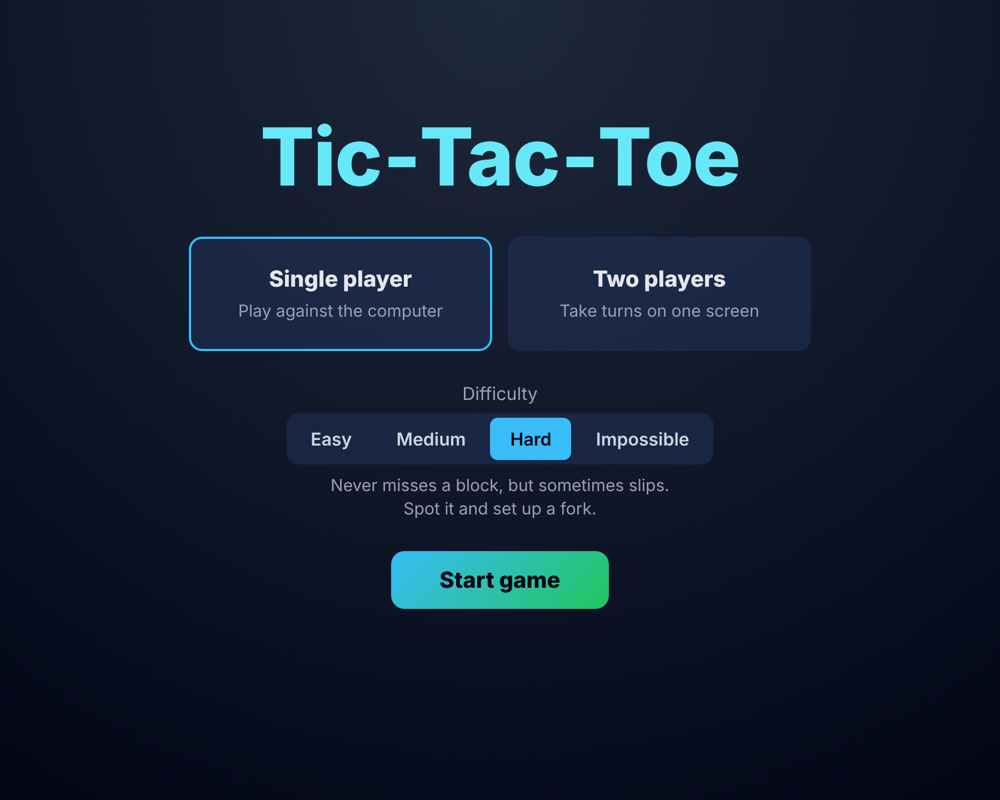
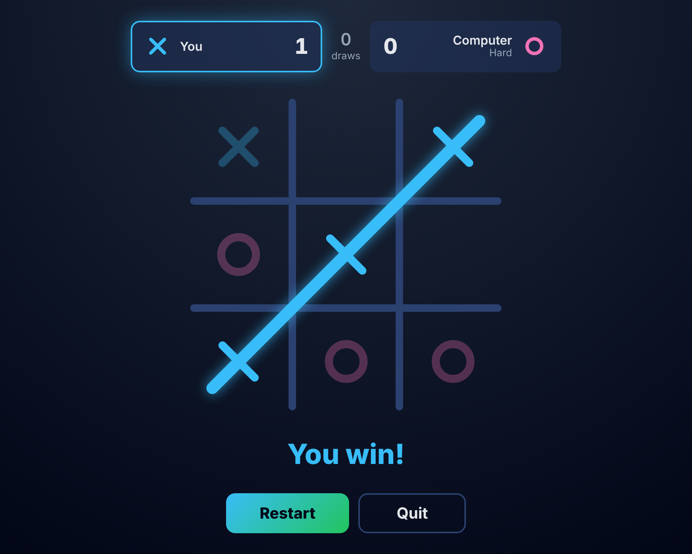
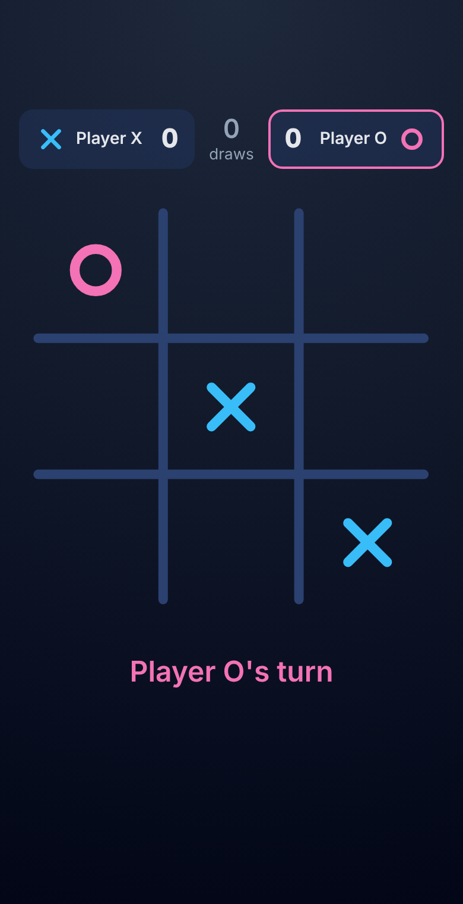

# Tic-Tac-Toe: Spring Boot + React

**[▶ Play it live](https://tictactoe-43rh.onrender.com)** (the first visit can take up to a minute while the free server wakes up)

A full-stack Tic-Tac-Toe game. The **Spring Boot REST API** holds all the game rules: move validation, win and draw detection, and a computer opponent with **four difficulty levels**, from a simple rule-based player up to an unbeatable **minimax** AI. The **React (Vite) frontend** draws the board with animated marks and shows whose turn it is.

<p align="center">
  
  
  
</p>

---

## Features

- **Two modes**
  - **Single player**: play X against the computer (O) at four difficulty levels
  - **Two players**: take turns on one screen; the starting player alternates each game
- **Four difficulty levels that play differently** (see [Difficulty levels](#difficulty-levels))
- **Server-side game logic**: the backend validates every move, so the client can't make illegal ones
- **Game flow**: a menu to pick the mode and difficulty, a game screen with no way to switch modes mid-game, and **Restart** / **Quit** when a game ends
- **Animations**: X and O are drawn as strokes, an animated slash goes through the winning line, and there's a hover preview and press feedback on the board
- **Responsive UI** that works on phones, with keyboard focus styles and reduced-motion support
- **Snappy on a slow server**: your move shows instantly (optimistic update), double-taps are blocked, and the page wakes the free server as soon as it opens
- **Clean error handling**: a global exception handler returns consistent JSON errors (`404` for an unknown game, `400` for an occupied cell, a finished game or an invalid index)
- **30 unit tests** with JUnit 5, including tests that play **every possible game** against the AI
- **Deployed** on Render: the backend in a Docker container, the frontend as a static site

## Tech stack

| Layer | Technology |
|---|---|
| Backend | Java 17, Spring Boot 4 (Web MVC, Validation), Maven |
| Frontend | React 19, Vite, JavaScript, CSS, SVG |
| Testing | JUnit 5 |
| Storage | In-memory (`ConcurrentHashMap`) |
| Deployment | Docker (multi-stage build), Render |

## How the AI works

### Minimax

When the computer needs to play perfectly, the backend tries every empty cell and scores the resulting position with **minimax**, assuming both sides always play their best reply until the end of the game:

- A win for O scores `10 - depth`, a win for X scores `depth - 10`, and a draw scores `0`
- `depth` is how many moves away the result is, so the AI **wins as fast as it can** and, when it's losing, **still blocks and makes you earn the win** instead of giving up
- **Alpha-beta pruning** skips branches that can't change the result, so a move is calculated in about a millisecond

### Difficulty levels

Each level has its own strategy:

| Level | How it plays |
|---|---|
| **Easy** | Takes a win if it sees one, otherwise plays randomly. Never blocks you. |
| **Medium** | Takes its wins and blocks yours, otherwise plays randomly. |
| **Hard** | Always takes its wins and blocks yours. On any other turn, half the time it makes a *quiet mistake*: a move that looks safe but lets a sharp player set up a **fork** (two threats at once). If you miss it, it goes straight back to perfect play. |
| **Impossible** | Always plays the minimax move. The best you can get is a draw. |

Easy and Medium are **rule-based** (they only look one move ahead). Hard and Impossible are **search-based** (minimax looks to the end of the game).

**Simulated win rates** (2,000 games per level against three kinds of player):

| Level | Random player | Careful player (takes wins, blocks) | Perfect player |
|---|---|---|---|
| Easy | 38% | 90% | 96% |
| Medium | 5% | 31% | 77% |
| Hard | 4% | 24% | 64% |
| Impossible | 0% | 0% | 0% |

The random number generator is passed into `GameService` through its constructor, so tests can use a fixed one and get the same "random" moves on every run.

## API

Base URL: `http://localhost:8080/api` (live: `https://tictactoe-api-al4h.onrender.com/api`)

| Method | Endpoint | Body | Description |
|---|---|---|---|
| `POST` | `/games` | `{ "gameMode": "SINGLE_PLAYER", "difficulty": "HARD" }` | Create a new game. `gameMode` is `SINGLE_PLAYER` or `MULTI_PLAYER`; `difficulty` (`EASY`, `MEDIUM`, `HARD`, `IMPOSSIBLE`) applies to single player and defaults to `IMPOSSIBLE` |
| `GET` | `/games/{gameId}` | – | Get the current game state |
| `POST` | `/games/{gameId}/moves` | `{ "cellIndex": 0-8 }` | Make a move (the computer replies in the same response in single-player mode) |
| `GET` | `/health` | – | Returns `{"status":"ok"}`; used to wake the server and by uptime monitoring |

**Example response**

```json
{
  "gameId": "3f1c2b9e-...",
  "board": ["X", "_", "_", "_", "O", "_", "_", "_", "_"],
  "currentPlayer": "X",
  "status": "IN_PROGRESS",
  "difficulty": "HARD"
}
```

`status` is one of `IN_PROGRESS`, `X_WON`, `O_WON`, `DRAW`. `difficulty` is `null` in two-player games.

Board cells are indexed like this:

```
 0 | 1 | 2
---+---+---
 3 | 4 | 5
---+---+---
 6 | 7 | 8
```

## Project structure

```
TicTacToe/
├── tictactoe/                  Spring Boot backend
│   ├── src/main/java/com/example/tictactoe/
│   │   ├── controller/         GameController (REST endpoints), HealthController
│   │   ├── service/            GameService (rules, minimax AI, difficulty strategies)
│   │   ├── repository/         In-memory GameRepository
│   │   ├── entity/, domain/    Game, GameMode, Difficulty, Player, GameStatus
│   │   ├── dto/                Request/response objects
│   │   ├── config/             CorsConfig (allowed origins from an environment variable)
│   │   └── exception/          Custom exceptions + GlobalExceptionHandler
│   ├── src/test/java/...       GameServiceTest (JUnit 5)
│   └── Dockerfile              Multi-stage build used by Render
├── tictactoe-ui/               React + Vite frontend
│   └── src/App.jsx, index.css
└── Pictures/                   Screenshots
```

## Running locally

**Prerequisites:** JDK 17+, Node.js 20+

**1. Start the backend** (runs on port 8080)

```bash
cd tictactoe
./mvnw spring-boot:run        # Windows: mvnw.cmd spring-boot:run
```

**2. Start the frontend** (runs on port 5173)

```bash
cd tictactoe-ui
npm install
npm run dev
```

**3.** Open http://localhost:5173, pick a mode (and a difficulty for single player) and click **Start game**.

**Run the tests**

```bash
cd tictactoe
./mvnw test                   # Windows: mvnw.cmd test
```

## Deployment

Both parts run on [Render](https://render.com)'s free plan:

| Part | Render service | Settings |
|---|---|---|
| Backend | Web Service (Docker) | Root directory `tictactoe`; env var `CORS_ALLOWED_ORIGINS` = the frontend URL |
| Frontend | Static Site | Root directory `tictactoe-ui`, build `npm ci && npm run build`, publish `dist`; env var `VITE_API_URL` = the backend URL |

Render redeploys both automatically when `main` changes. The free backend sleeps after 15 minutes without visitors, so an uptime monitor calls `/api/health` to keep it awake.

## Planned improvements

- Online two-player mode over WebSockets, so two people can play from their own devices
- Sound effects and a fuller layout
- Save games in a database instead of in memory

## Author

**Seetharaman Kumar Iyer**, [GitHub @Benex1114](https://github.com/Benex1114) · [LinkedIn](https://www.linkedin.com/in/seetharaman1411)
