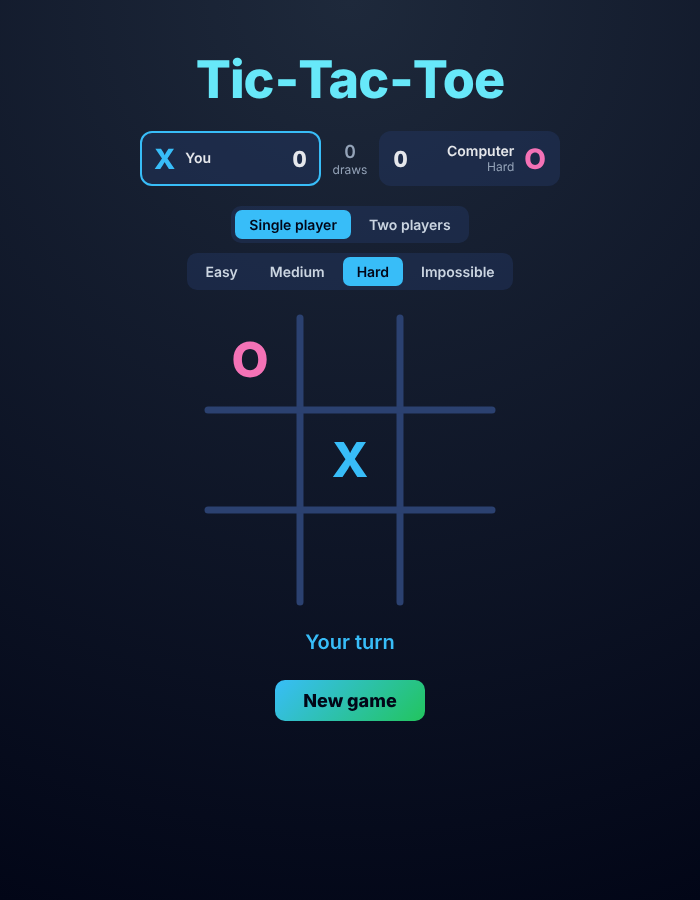
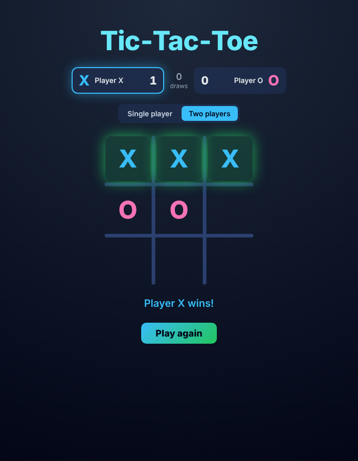
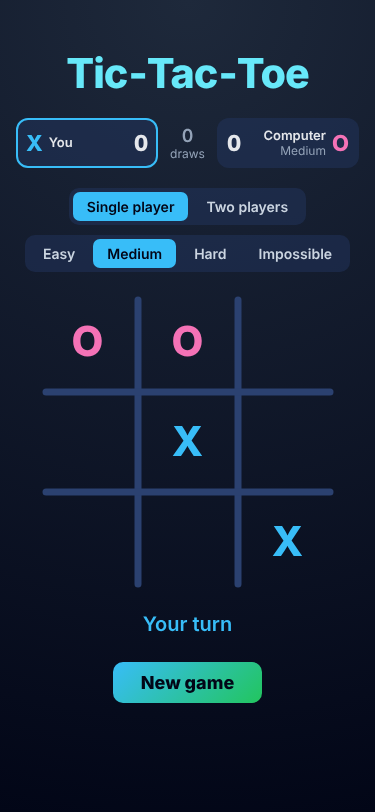

# Tic-Tac-Toe: Spring Boot + React

A full-stack Tic-Tac-Toe game. The **Spring Boot REST API** holds all the game rules: move validation, win and draw detection, and a **minimax AI** opponent with four difficulty levels. The **React (Vite) frontend** draws the board, shows whose turn it is and keeps score.

<p align="center">
  
  
  
</p>

---

## Features

- **Two modes**
  - **Single Player**: play X against the computer (O) at four difficulty levels: Easy, Medium, Hard and Impossible
  - **Two Player**: two players on one screen; the starting player alternates between X and O each game
- **Unbeatable AI on Impossible**: uses the **minimax** algorithm and never loses (verified by a test that plays every possible game)
- **Server-side game logic**: the backend validates every move, so the client can't make illegal ones
- **Win detection** across all 8 lines, with the winning line highlighted
- **Player bar** showing scores and draws, with the current player's side lit up in their colour
- **Responsive UI** that works on phones, with keyboard focus styles and reduced-motion support
- **Clean error handling**: a global exception handler returns consistent JSON errors (`404` for an unknown game, `400` for an occupied cell, a finished game or an invalid index)
- **Input validation** with Jakarta Bean Validation (`cellIndex` must be 0–8)
- **23 unit tests** with JUnit 5 covering game rules, move validation, difficulty and the AI

## Tech stack

| Layer | Technology |
|---|---|
| Backend | Java 17, Spring Boot 4 (Web MVC, Validation), Maven |
| Frontend | React 19, Vite, JavaScript, CSS |
| Testing | JUnit 5 |
| Storage | In-memory (`ConcurrentHashMap`) |

## How the AI works

When it's O's turn in single-player mode, the backend tries every empty cell and scores the resulting position using **minimax**:

- `+10` if O wins, `-10` if X wins, `0` for a draw
- O picks the move with the highest score, assuming X always plays its best reply

Tic-Tac-Toe has a small game tree, so a full search runs instantly and the AI plays perfectly.

### Difficulty levels

Each level is the probability that the AI plays its best (minimax) move. Otherwise it plays a random empty cell.

| Level | Best move played |
|---|---|
| Easy | 20% of the time |
| Medium | 50% of the time |
| Hard | 80% of the time |
| Impossible | Always (can't be beaten) |

The random number generator is passed into `GameService` through its constructor, so tests can use a fixed seed and get the same result on every run.

## API

Base URL: `http://localhost:8080/api/games`

| Method | Endpoint | Body | Description |
|---|---|---|---|
| `POST` | `/api/games` | `{ "gameMode": "SINGLE_PLAYER", "difficulty": "HARD" }` | Create a new game. `gameMode` is `SINGLE_PLAYER` or `MULTI_PLAYER`; `difficulty` (`EASY`, `MEDIUM`, `HARD`, `IMPOSSIBLE`) applies to single player and defaults to `IMPOSSIBLE` |
| `GET` | `/api/games/{gameId}` | – | Get the current game state |
| `POST` | `/api/games/{gameId}/moves` | `{ "cellIndex": 0-8 }` | Make a move (the AI replies automatically in single-player mode) |

**Example response**

```json
{
  "gameId": "3f1c2b9e-...",
  "board": ["X", "_", "_", "_", "O", "_", "_", "_", "_"],
  "currentPlayer": "X",
  "status": "IN_PROGRESS",
  "difficulty": "HARD"
}
```

`status` is one of `IN_PROGRESS`, `X_WON`, `O_WON`, `DRAW`. `difficulty` is `null` in two-player games.

Board cells are indexed like this:

```
 0 | 1 | 2
---+---+---
 3 | 4 | 5
---+---+---
 6 | 7 | 8
```

## Project structure

```
TicTacToe/
├── tictactoe/                  Spring Boot backend
│   ├── src/main/java/com/example/tictactoe/
│   │   ├── controller/         GameController (REST endpoints)
│   │   ├── service/            GameService (rules, minimax AI, difficulty)
│   │   ├── repository/         In-memory GameRepository
│   │   ├── entity/, domain/    Game, GameMode, Difficulty, Player, GameStatus
│   │   ├── dto/                Request/response objects
│   │   └── exception/          Custom exceptions + GlobalExceptionHandler
│   └── src/test/java/...       GameServiceTest (JUnit 5)
├── tictactoe-ui/               React + Vite frontend
│   └── src/App.jsx, index.css
└── Pictures/                   Screenshots
```

## Running locally

**Prerequisites:** JDK 17+, Node.js 20+

**1. Start the backend** (runs on port 8080)

```bash
cd tictactoe
./mvnw spring-boot:run        # Windows: mvnw.cmd spring-boot:run
```

**2. Start the frontend** (runs on port 5173)

```bash
cd tictactoe-ui
npm install
npm run dev
```

**3.** Open http://localhost:5173, pick a mode (and a difficulty for single player) and click **New game**.

**Run the tests**

```bash
cd tictactoe
./mvnw test                   # Windows: mvnw.cmd test
```

## Planned improvements

- Deploy to Render with a live demo link
- Online two-player mode over WebSockets, so two people can play from their own devices
- Save games in a database instead of in memory

## Author

**Seetharaman Kumar Iyer**, [GitHub @Benex1114](https://github.com/Benex1114)
